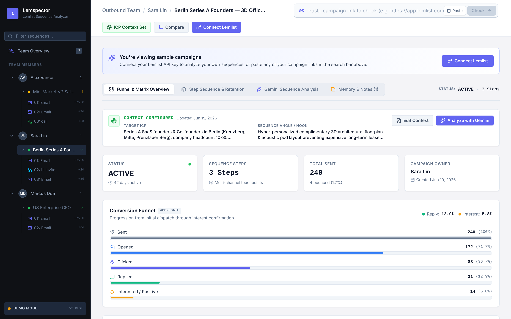
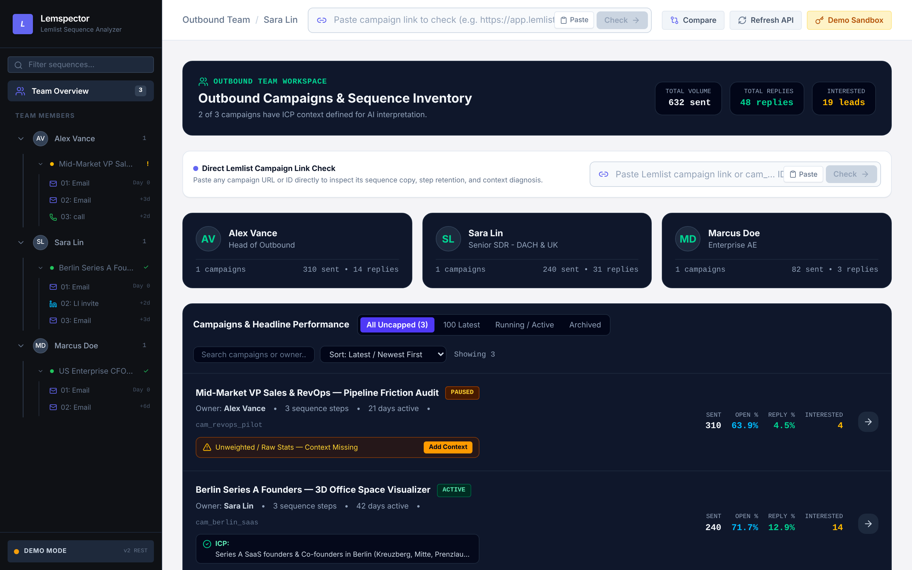
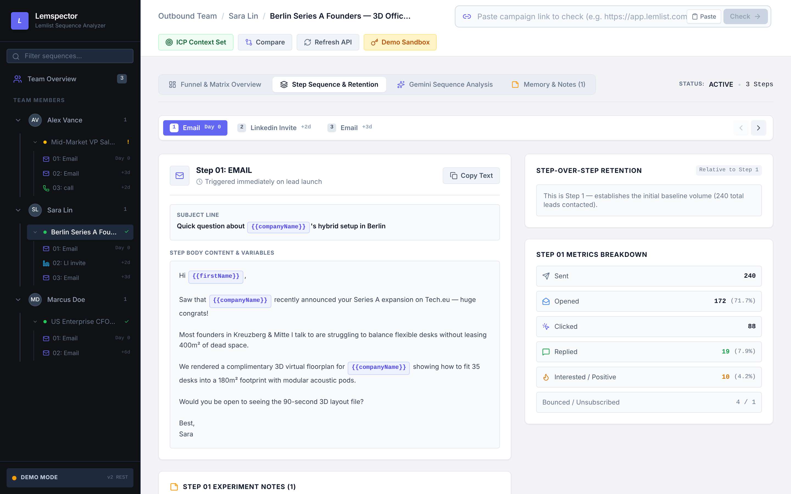
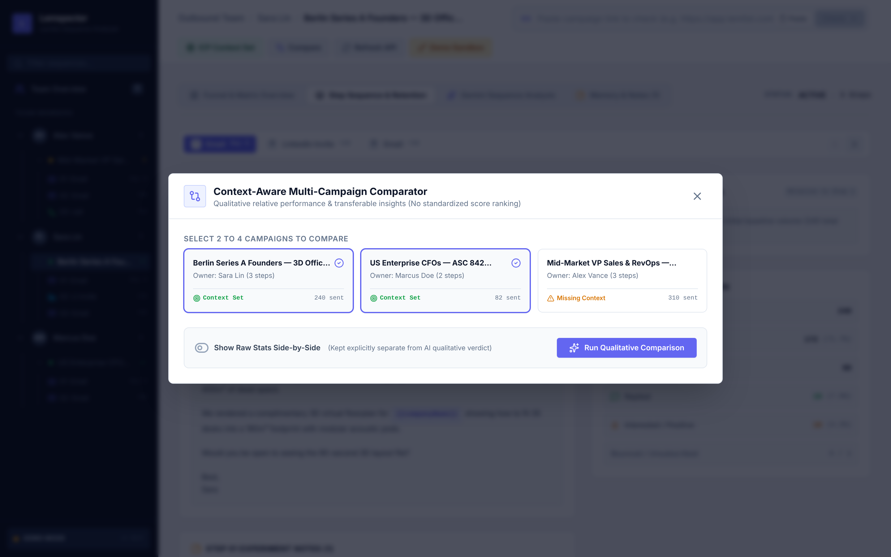

<div align="center">

# 🔍 Lemspector

**AI-powered inspector for Lemlist campaigns and sequences.**

See exactly where each sequence leaks leads, then get recommendations from Gemini that take your ICP and outreach angle into account.

[](https://github.com/amarsigireddi-source/Lemspector/actions/workflows/ci.yml)


[](LICENSE)



</div>

---

## Why Lemspector?

Lemlist reports what happened in a campaign. Lemspector helps explain **why**. A 4% reply rate means one thing for Series A founders and something very different for Fortune 500 CFOs. Lemspector holds each campaign's raw numbers next to its **audience (ICP)** and **angle**, so its diagnosis can say whether a weak step comes from the copy, the targeting, or the timing.

## ✨ Features

| | |
|---|---|
| 📊 **Funnel & matrix overview** | Sent → Opened → Clicked → Replied → Interested, with a step-by-step performance grid |
| 🪜 **Step-over-step retention** | See the drop-off between each email, LinkedIn and call step, and find out where sequence fatigue starts |
| 🎯 **ICP & angle context** | Give each campaign its target audience and hook so the stats are read against them |
| 🤖 **Gemini sequence analysis** | Get a structured diagnosis: strengths, leak points, and rewrites for each step |
| ⚖️ **Multi-campaign comparison** | Compare 2–4 campaigns qualitatively and find insights that carry over between them |
| 👥 **Team overview** | Volume, replies and interested leads for each team member and campaign |
| 🔗 **Campaign link checker** | Paste any Lemlist campaign URL or ID to inspect it instantly |
| 📝 **Memory & notes** | Experiment notes for each step, plus a history of past AI verdicts |
| 🧪 **Demo mode** | Runs out of the box with sample campaigns, no API keys needed |

## 📸 Screenshots

<table>
  <tr>
    <td><p align="center"><b>Team overview</b></p></td>
    <td><p align="center"><b>Step sequence & retention</b></p></td>
  </tr>
  <tr>
    <td colspan="2"><p align="center"><b>Context-aware campaign comparison</b></p></td>
  </tr>
</table>

## 🚀 Quick start

**Prerequisites:** Node.js 20+

```bash
git clone https://github.com/amarsigireddi-source/Lemspector.git
cd Lemspector
npm install
cp .env.example .env   # then add your GEMINI_API_KEY
npm run dev
```

Open **http://localhost:3000**. The app starts in **demo mode** with sample campaigns.

### Use it with your own Lemlist data

Anyone can use Lemspector with their own workspace. Nothing is shared between visitors.

1. In Lemlist, go to **Settings → Integrations → API** and generate an API key.
2. In Lemspector, click **Connect Lemlist** and paste the key. It's checked before it's saved.
3. Your team's campaigns, steps, and stats sync automatically.

**Have a campaign link?** Paste any `https://app.lemlist.com/...cam_...` URL or a bare `cam_...` ID into the search bar. If you haven't connected yet, Lemspector asks for your key and then opens that campaign straight away.

> 🔒 **Privacy:** your Lemlist key lives only in your browser's `localStorage`. It's sent with each request to the Lemspector server, which forwards it to `api.lemlist.com` and never stores or logs it. Cached campaign data is kept per workspace for 30 seconds to avoid Lemlist rate limits. Click **Disconnect** to remove the key.

## ⚙️ Configuration

| Variable | Required | Description |
|---|---|---|
| `GEMINI_API_KEY` | Recommended | Google Gemini key for AI analysis. Without it, a rule-based diagnosis is used. Get one at [aistudio.google.com/apikey](https://aistudio.google.com/apikey) |
| `PORT` | No | Server port (default `3000`) |

There's deliberately no Lemlist setting: every visitor brings their own key.

## 🌍 Deploying a public instance

Lemspector is a single Node server, so any Node host works (Render, Railway, Fly.io, Cloud Run, a VPS):

```bash
npm ci && npm run build
GEMINI_API_KEY=your-key npm start
```

Things to know before you share the link:
- **Lemlist data is per visitor.** Each person connects their own key, and one visitor can never see another's workspace.
- **Gemini usage is billed to you.** Every visitor's AI analysis uses the `GEMINI_API_KEY` you set. Set a quota in Google AI Studio, or leave it unset to use only the free rule-based diagnostics.
- **Serve over HTTPS** so API keys are encrypted in transit. Most hosts do this by default.

## 🏗️ How it works

```
┌─────────────────────┐      ┌──────────────────────────┐      ┌──────────────────┐
│  React 19 + Vite    │ ───▶ │  Express server          │ ───▶ │  Lemlist REST API │
│  Tailwind v4 UI     │      │  (server.ts)             │      └──────────────────┘
│  localStorage state │      │  • Lemlist proxy         │      ┌──────────────────┐
└─────────────────────┘      │  • Gemini analysis       │ ───▶ │  Google Gemini    │
                             └──────────────────────────┘      └──────────────────┘
```

| Endpoint | Purpose |
|---|---|
| `GET  /api/health` | Health check |
| | *All `/api/lemlist/*` routes require the visitor's key in the `x-lemlist-api-key` header* |
| `POST /api/lemlist/test-connection` | Validate a Lemlist API key |
| `GET  /api/lemlist/team` | Team members |
| `GET  /api/lemlist/campaigns` | Campaigns with enriched step stats |
| `GET  /api/lemlist/campaigns/:id` | Single campaign detail |
| `POST /api/analyze/campaign` | Gemini diagnosis for one campaign |
| `POST /api/analyze/compare` | Gemini comparison across campaigns |

### Project structure

```
├── server.ts              # Express API: Lemlist proxy + Gemini endpoints
├── src/
│   ├── App.tsx            # App shell, state & data sync
│   ├── components/        # Tabs, modals, sidebar, header
│   ├── sampleData.ts      # Demo-mode campaigns (fictional)
│   ├── types.ts           # Shared TypeScript types
│   └── utils.ts           # Storage helpers & stat calculations
└── docs/screenshots/      # README images
```

## 📦 Scripts

| Command | Description |
|---|---|
| `npm run dev` | Start the dev server with hot reload |
| `npm run build` | Build the client and bundle the server into `dist/` |
| `npm start` | Run the production build |
| `npm run lint` | Type-check with `tsc` |

## 🤝 Contributing

Issues and pull requests are welcome. Run `npm run lint && npm run build` before you open a PR.

## 📄 License

[MIT](LICENSE)

---

<sub>Lemspector is an independent project and is not affiliated with or endorsed by lemlist.</sub>
